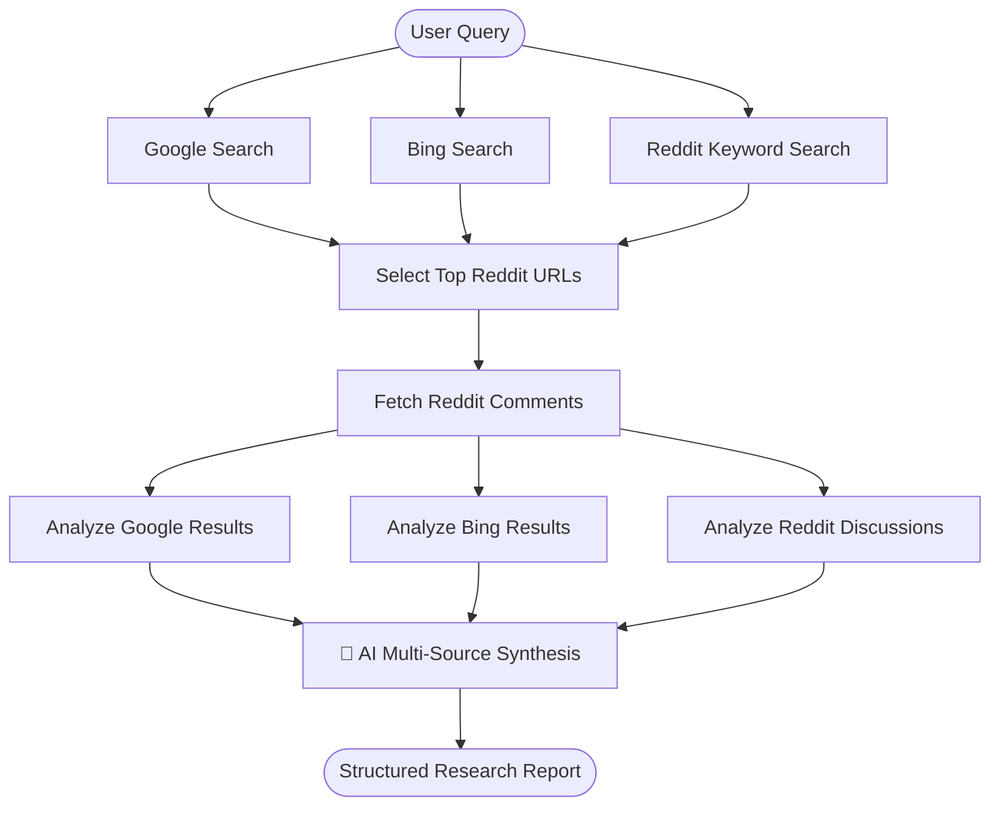

# 🔬 Multi-Source AI Research Agent

An autonomous research agent built with **LangGraph**, **Google Gemini**, and **BrightData**, wrapped in an interactive dark-themed **Streamlit** dashboard.

The agent queries **Google Search**, **Bing Search**, and **Reddit** concurrently, deep-dives into high-signal community discussion threads and comments, and synthesizes all evidence into a comprehensive, cited intelligence report.

---

## 🏗️ Architecture & Pipeline



1. **Parallel Web Discovery:** Concurrent queries dispatched across Google, Bing, and Reddit via BrightData's SERP and Web Unlocker APIs.
2. **Reddit Deep-Dive:** An LLM inspects community search titles to select the top 3 highest-signal discussion threads, then fetches full comment trees.
3. **Concurrent Multi-Source Analysis:** Individual LLM analysis nodes extract verified facts, consensus, contrarian views, and community sentiments per source in parallel.
4. **Final Synthesis:** A synthesis prompt consolidates all findings into a structured report with markdown headers, source citations, and a bottom-line takeaway.

---

## 📁 Project Structure

```
research-web-agent/
├── agent/                         # Core agent package (Single Source of Truth)
│   ├── __init__.py                # Exports compiled `graph`
│   ├── graph.py                   # LangGraph StateGraph & workflow nodes
│   ├── prompts.py                 # LLM prompts & message builders
│   ├── web_operations.py          # BrightData SERP & Reddit API wrappers
│   └── snapshot_operations.py     # Asynchronous dataset snapshot polling
│
├── .streamlit/
│   └── config.toml                # Dark theme & headless server config
│
├── app.py                         # Streamlit Web UI (flicker-free live tracker)
├── main.py                        # Terminal CLI runner
├── pyproject.toml                 # Dependencies & packaging metadata
├── .env.example                   # Environment variable template
└── README.md                      # Documentation
```

---

## 🚀 Quickstart

### 1. Prerequisites
- Python 3.11+
- [uv](https://docs.astral.sh/uv/) (recommended) or `pip`

### 2. Environment Setup
Create a `.env` file in the project root:

```env
GOOGLE_API_KEY=your_gemini_api_key_here
BRIGHTDATA_API_KEY=your_brightdata_api_key_here
```


### 3. Run the Streamlit Web UI (Recommended)

```bash
# Using uv
uv run streamlit run app.py

# Or using the local virtualenv
.venv\Scripts\streamlit.exe run app.py
```
Open **http://localhost:8501** in your browser.

### 4. Run the Terminal CLI Chatbot

```bash
# Using uv
uv run python main.py

# Or using python
python main.py
```

---

## 🎨 UI Features
- **True Dark Theme:** Deep `#0a0c10` palette with high-contrast typography and subtle purple accents (`#7c6eff`).
- **Flicker-Free Live Stepper:** Powered by `@st.fragment(run_every=1.0)` for smooth, in-place progress updates with zero page reloads.
- **One-Click Query Suggestions:** Quick-start chips to explore complex technical topics with a single click.
- **Evidence Tabs:** Inspect raw analyses and click directly into the Reddit discussion threads crawled by the agent.
